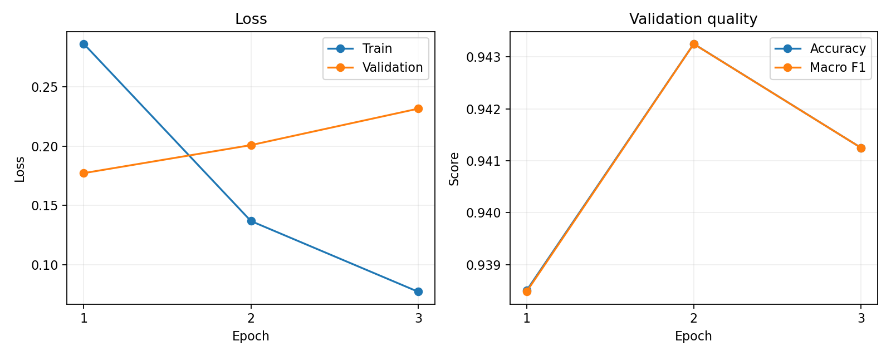

# 用户评论情感分析

[English](README.md) | 简体中文

对电影和商品评论进行正面、负面二分类。项目包含已实测的 TF-IDF＋逻辑回归基线，以及基于 PyTorch、Hugging Face Transformers 的 DistilBERT/BERT 微调流程。

## 当前完成情况

- Amazon 基线已用真实标签完成训练与评估，结果见下表。
- 真实预训练 DistilBERT 已完成 3 轮微调，在独立测试集上取得 93.15% 准确率、0.9315 宏平均 F1，比相同划分的基线提高 4.45 个百分点。速度对比尚未测量。
- IMDb 流程要求带标签的原始数据。旧的无标签 CSV 已移出项目，不能通过评论行号推断标签。

## 项目结构

```text
.
├── src/
│   ├── preprocessing.py        # 共享文本清洗
│   ├── run_amazon_baseline.py  # Amazon CSV 抽样、基线训练和评估
│   ├── run_amazon.py           # Amazon Transformer 训练、评估和预测入口
│   ├── run_imdb.py             # 共享 Transformer 分类器及 IMDb 入口
│   ├── read_amazon.py          # Amazon fastText bz2 数据准备
│   └── split_data.py           # IMDb 分层训练/测试划分
├── tests/test_training.py      # 离线流程测试
├── results/amazon_baseline_metrics.json
├── data/                      # 本地数据，不纳入 Git
├── requirements.txt
├── README.md
└── README.zh-CN.md
```

## 安装

在项目根目录执行。建议使用独立虚拟环境：

```bash
python -m venv .venv
source .venv/bin/activate
python -m pip install -r requirements.txt
```

首次加载预训练模型需要访问 Hugging Face；也可用 `--model-name` 指向本地预训练模型目录。大数据文件和模型权重不随仓库分发。

## Amazon 基线：已验证的运行方式

准备原始 `train.csv` 和 `test.csv`，放在同一目录。文件无表头，每行依次为 `label,title,review`，其中 1 表示负面，2 表示正面。

```bash
python src/run_amazon_baseline.py --source-dir /path/to/amazon_csv_directory
```

默认分别抽取每类 10,000 条训练评论、1,000 条测试评论，合并标题和正文并清洗；去除重复文本和训练/测试文本重叠，再从训练数据内分层留出 20% 验证集。抽样来自源文件前部的数据块，固定随机种子，因此不是全数据集的随机代表性评估。

输出包括 `data/amazon_train.csv`、`data/amazon_test.csv` 和 `results/amazon_baseline_metrics.json`。基线采用最多 50,000 个 unigram/bigram TF-IDF 特征和逻辑回归。

2026 年 10 月 13 日的实际运行结果：

| 指标 | 结果 |
| --- | --- |
| 训练样本 | 20,000 |
| 测试样本 | 2,000，正负各 1,000 |
| 准确率 | 89.60% |
| 宏平均 F1 | 0.8960 |
| 负面召回率 | 91.10% |
| 正面召回率 | 88.10% |

这些指标来自传统基线，不代表 DistilBERT 的性能。

## Transformer 微调、评估与预测

生成上述带标签的 Amazon CSV 后：

```bash
python src/run_amazon.py --train --evaluate --data-dir data --output-dir weights-distilbert --epochs 3
python src/run_amazon.py --evaluate --data-dir data --output-dir weights-distilbert
python src/run_amazon.py --predict "The product is not bad at all." --output-dir weights-distilbert
```

默认模型为 `distilbert-base-uncased`，可通过 `--model-name bert-base-uncased` 运行 BERT 对照实验。训练从指定预训练模型开始，不会自动续训输出目录里的 checkpoint；不同实验应使用不同输出目录。

文本清洗包括 HTML/实体处理、Unicode 归一化、小写和空白归一化，保留否定词、标点、emoji 和其他语言字符。序列默认截断至 256 tokens，按 batch 动态 padding，并使用 attention mask。

训练从准备好的训练 CSV 内分层留出 20% 验证集。默认参数：学习率 `2e-5`、batch size `16`、最多 `3` 个 epoch、权重衰减 `0.01`、warmup 比例 `0.1`、梯度裁剪 `1.0`。使用 AdamW 与线性 warmup/decay；验证 loss 连续 2 轮未改善时早停，保存验证 loss 最低的模型。

训练记录写入输出目录下的 `training_history.json`，包括每轮训练 loss、验证 loss/accuracy/F1、样本数及最多 1,000 条训练评论的 token 长度统计。最终测试指标写入 `test_metrics.json`。独立评估和预测要求已有训练 checkpoint。

## 同一划分上的实际模型对比

两个模型使用相同的 16,000 条训练、4,000 条验证和 2,000 条测试评论；训练/验证分层划分随机种子为 42，已核对评论内容及顺序一致。基线使用固定超参数，DistilBERT 按验证 loss 选择 checkpoint。两者均未根据测试集调参。

| 模型 | 测试准确率 | 宏平均 F1 |
| --- | --- | --- |
| TF-IDF＋逻辑回归 | 88.70% | 0.8870 |
| DistilBERT 微调 | 93.15% | 0.9315 |

DistilBERT 负面召回率 95.80%，正面召回率 90.50%。混淆矩阵为 `[[958, 42], [95, 905]]`，行是真实标签、列是预测标签，顺序均为负面、正面。

3 轮验证准确率依次为 93.85%、94.33%、94.13%；验证 loss 依次为 0.1772、0.2008、0.2314。训练 loss 持续下降，但验证 loss 上升，出现过拟合迹象。按预先确定的最低验证 loss 规则选择第 1 轮权重进行最终测试。



结果见 `results/model_comparison.json`、`results/distilbert_training_history.json` 和 `results/distilbert_test_metrics.json`。历史 89.60% 基线使用了全部 20,000 条训练评论，保留作独立记录，不用于本次公平对比。此次为单随机种子、抽样实验，未做统计显著性或 BERT 速度对比。

复现已准备数据上的公平基线和结果汇总：

```bash
python src/run_amazon_baseline.py --prepared-data-dir data --result-file results/amazon_baseline_matched_metrics.json
python src/run_amazon.py --train --evaluate --data-dir data --output-dir weights-distilbert-amazon --epochs 3 --batch-size 16 --max-length 256
python src/summarize_experiment.py --checkpoint weights-distilbert-amazon
```

## 其他数据入口

IMDb 原始 CSV 必须具有 `review` 和 `sentiment` 两列，标签为 `positive` 或 `negative`：

```bash
python src/split_data.py /path/to/IMDB_Dataset.csv --output-dir data --test-size 0.2 --seed 42
python src/run_imdb.py --train --evaluate --data-dir data --output-dir weights-imdb
```

Amazon fastText bz2 数据每行须以 `__label__1` 或 `__label__2` 开头：

```bash
python src/read_amazon.py /path/to/train.ft.txt.bz2 --output-dir data --sample-size 10000
python src/run_amazon.py --train --evaluate --data-dir data --output-dir weights-amazon
```

这会重新生成同名 Amazon train/test CSV，运行前注意保存需要保留的数据划分。

## 验证与限制

### 误分类案例

已重新推理复现 137 条测试错误：95 条正面被判为负面、42 条负面被判为正面。整理了 8 条真实错误的摘要，覆盖混合情感、评价对象混淆、正面习惯表达、疑似标签歧义及截断案例。71 条错误的未校准模型分数至少为 0.9；仅 1 条错误涉及截断，不能把主要问题归因于长度。

详见 [中文版误分类分析](docs/error-analysis.zh-CN.md) 和 [汇总统计](results/error_analysis_summary.json)。原因解释是人工分析假设；未修改数据标签或模型，也未改变原测试成绩。

```bash
python -m unittest discover -s tests -v
```

测试覆盖清洗、标签校验以及小型随机模型的训练、验证、保存、测试和预测闭环。它验证代码流程，不衡量预训练模型的实际情感识别能力。

当前未验证讽刺、多语言混合或中文场景；模型输出的 softmax 分数尚未进行概率校准。历史实验的约 92% IMDb 成绩存在标签配对问题，不能作为当前项目成果引用。只报告真实复跑产生的指标。

请遵循原始数据和预训练模型各自的使用及分发条款；仓库保留代码和评估结果，数据与权重保存在本地。
